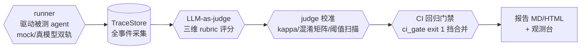
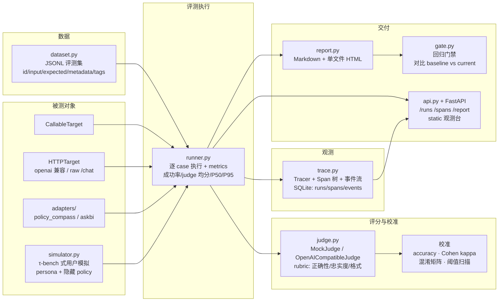

# agenteval — 自研 Agent 评测与可观测平台

[](https://github.com/anlanjc/agenteval/actions/workflows/ci.yml) []() []() []()

## 架构总览



> 会做项目，更要会**量化**项目。这个仓库不接入 Langfuse / RAGAS / LangChain，
> 从零实现了一个 Agent 评测平台的完整闭环：**trace 采集 → LLM-as-judge 评分 → judge 校准
> （accuracy / Cohen's kappa / 混淆矩阵 / 阈值扫描）→ CI 回归门禁 → Markdown/HTML 报告 → 观测台**。
>
> 作者背景：准备 2027 寒假 Agent 应用开发实习。已有三个 Agent 项目（同工作区的
> policy-compass / askbi / miniagent），本项目负责回答面试高频题：
> *"优化了多少、怎么测的？""LLM-as-judge 可靠吗、怎么校准？""Agent 效果怎么回归？"*

---

## 架构



一次评测在 trace 里的形状（`GET /spans/{run_id}` 可查）：

```
run "cli-smoke"                      ← 根 span，聚合耗时
├── case[pc-001]                     ← 每个 case 一个子树
│   ├── target.call                  ← 请求/响应事件、token 估算
│   └── judge.score                  ← judge 各维度分与结论事件
├── case[pc-002]
│   └── ...
└── ...
```

## 快速开始

环境：Windows + Git Bash，Python ≥ 3.10。安装依赖**必须带官方源**（默认清华源会 403）：

```bash
cd agenteval
python -m venv .venv
.venv/Scripts/python -m pip install -i https://pypi.org/simple/ -r requirements.txt
```

跑测试（不依赖网络与任何付费 API，104 个用例）：

```bash
.venv/Scripts/python -m pytest tests/        # 104 passed
```

mock 模式自评测（judge 校准 + 回归门禁演示，产出 `.agenteval/selfeval/` 下的全部产物）：

```bash
.venv/Scripts/python -m agenteval.selfeval
```

CLI 四件套：

```bash
# 跑评测（mock target 开箱即跑；也支持 --target http --base-url http://127.0.0.1:8000
# 或 --target openai 走 /v1/chat/completions）
python -m agenteval run --dataset builtin:policy_compass_smoke --target mock --judge mock

# 回归门禁：任一指标劣化超阈值 → 非零退出码（CI 直接可用）
python -m agenteval gate --baseline <baseline.json> --current <current.json> \
    --threshold judge_mean=0.5 --threshold latency_p95_ms=3000

# 从 run 重新出报告
python -m agenteval report --run-id <id> --format html

# judge 校准（对 scores.json 做 accuracy/kappa/混淆矩阵 + 阈值扫描）
python -m agenteval calibrate --scores .agenteval/selfeval/scores_v1.json
```

观测台（FastAPI + 单文件 HTML，fetch /runs 与 /spans 渲染 run 列表与 span 树）：

```bash
.venv/Scripts/python -m uvicorn agenteval.api:app --port 8000
# 打开 http://127.0.0.1:8000/  →  "触发一次评测" 一键跑内置 smoke 数据集
```

接真实模型：judge 与 LLM 模拟器走 OpenAI 兼容接口（默认 DashScope compatible-mode），
凭据全部从环境变量读取：

```bash
export AGENTEVAL_LLM_BASE_URL=https://dashscope.aliyuncs.com/compatible-mode/v1
export AGENTEVAL_LLM_API_KEY=sk-...
export AGENTEVAL_LLM_MODEL=qwen-plus
# 缺 key 时抛 MissingCredentialsError 并提示 --judge mock 降级，而不是崩
```

接同工作区的两个 Agent 项目（只读对接，绝不修改它们；测试用 MockTransport 模拟其响应）：

```bash
python -m agenteval run --dataset builtin:policy_compass_smoke \
    --target http --adapter policy_compass --base-url http://127.0.0.1:8001  # POST /api/chat
# askbi 走 SSE：agenteval/adapters/askbi.py 解析 /api/ask 的 final 事件（role 可按用例透传）
```

## CI 跨项目回归门禁（真集成，2026-10-29）

**评测平台不是孤岛**：askbi 与 policy-compass 的 GitHub Actions 已各自接入 `eval-gate`
job——起主项目 mock 模式服务 → agenteval 打真 HTTP 跑 30 条 smoke → gate 对比仓库内基线
→ 任一正确性指标劣化即 exit 1 挡合并，全链路零 API key：

```yaml
# 主项目 .github/workflows/ci.yml 的门禁 step（完整 job 见两项目仓库与 docs/ci_integration.md）
- run: bash agenteval/scripts/ci_gate.sh askbi http://127.0.0.1:8000 \
      agenteval/baselines/askbi_smoke_baseline.json   # FAIL → exit 1 拦截合并
```

- `scripts/ci_gate.sh`：run→gate 一键门禁（时延阈值默认放大，正确性指标是信号）。
- `scripts/ci_fault_demo.py`：门禁有效性演示——注入 8 条用例劣化 → FAIL(exit 1) → 修复 → PASS(exit 0)，双项目实测。
- 前提：agenteval 推送到与主项目同 owner 的 GitHub。集成文档：`docs/ci_integration.md`；
  证据（确定性验证 + FAIL/PASS 全记录 + 红线 pytest）：`evidence/ci_gate_demo.md`。

## 评测结果（mock 模式，数字为真实运行产出）

> 运行命令：`python -m agenteval.selfeval`。构造 30 条带 golden 人工标注的 mock agent 输出
> （24 pass / 6 fail，故意埋 3 条答非所问、2 条数字捏造、1 条关键词半命中、1 条数字归因颠倒）。
> **以下为 mock 模式数字；真实模型数字需配置 key 后用同一命令复现。**

### ① Judge 校准（n=30）

| Judge 版本 | 决策阈值 | accuracy | Cohen's kappa | 混淆矩阵 (golden→predicted) |
| --- | --- | --- | --- | --- |
| v1（默认规则：超长答案 faithfulness 封顶 1 分） | 4.0 | 0.8333 | **0.5098** | pass→pass 21，pass→fail 3，fail→pass 2，fail→fail 4 |
| v1 + 仅做阈值扫描（最优） | 3.8 | 0.9333 | **0.7619** | — |
| v2（校准后：超长封顶 1→3 分；关键词命中分档收紧） | 4.0 | 0.9667 | **0.8889** | pass→pass 24，pass→fail 0，fail→pass 1，fail→fail 5 |
| v2 + 阈值扫描（确认最优） | 4.4 | 0.9667 | **0.8889** | — |

**读法**：v1 的 kappa 只有 0.51——误差分析显示 3 个 FN 全是"答案正确但超长"的用例（judge 偏严，
把长度当成了不忠实），2 个 FP 之一是"只覆盖 60% 要点却格式完整"的答案（分档过宽，60% 命中仍得 4 分）。
只调阈值最多到 0.76；修订评分规则后才到 0.89。残余 1 例 FP 是数字归因颠倒（"上海 120 万、北京 100 万"
说反了）——规则型 judge 的结构性盲区，正是需要真实 LLM judge 兜底的场景。

### ② 回归门禁演示

| 场景 | judge 均分 | judge 通过率 | 门禁结论 | 退出码 |
| --- | --- | --- | --- | --- |
| baseline（mock agent 全对） | 5.000 | 100% | — | — |
| current-healthy（同配置重跑） | 5.000 | 100% | PASS ✅ | 0 |
| current-degraded（8/30 注入错误输出） | 4.3167 | 73.33% | **FAIL ❌** | **1** |

门禁差异表（CLI 实际输出，judge_mean 降 1.09 > 阈值 0.3、judge_pass_rate 降 0.5 > 阈值 0.05）：

```
metric                baseline     current       delta        阈值  结果
judge_pass_rate              1         0.5        -0.5      0.05  FAIL
judge_mean                   5        3.91       -1.09       0.3  FAIL
门禁结论: FAIL ❌ 存在超阈值回归，禁止合入      → 退出码 1（CI 拦截）
```

### ③ 冒烟数据集（内置，v2.0.0 各 30 条，对齐两主项目各自 v2 评测集的代表性子集）

| 数据集 | 对接 | 分层 | 成功率 | judge 通过率 |
| --- | --- | --- | --- | --- |
| `builtin:askbi_smoke` v2 | askbi `POST /api/ask` SSE（支持 per-case role） | query17/drill4/clarify5/refusal4（含 south/north 行级权限） | 100% | 100%（judge_mean 4.707） |
| `builtin:policy_compass_smoke` v2 | policy-compass `POST /api/chat` | fact11/compare4/calc4/refuse4/timeliness3/slang3/multi1 | 100% | 100%（judge_mean 4.760） |

v1 的 10 条从未对活服务验证过（真打过去只有 10% 通过）；v2 是先全量探测主项目 v2 评测集
（askbi 116 / policy-compass 90 条），再用真实输出构建并用例级断言 keywords 的产物，
30/30 双项目实测。构建与确定性验证过程见 `evidence/ci_gate_demo.md` §1-2。

## 设计取舍：自研 vs 套平台

| 维度 | 本项目（自研） | Langfuse / RAGAS | LangSmith |
| --- | --- | --- | --- |
| 定位 | 评测 + 校准 + 门禁一体化，面向 CI | 偏观测/追踪，评测是插件 | 托管 SaaS，数据出内网 |
| judge 校准 | **对 golden 标注算 kappa/混淆矩阵，阈值可扫描**（面试核心叙事） | RAGAS 有指标但无"对人工标注校准 judge"的一等公民流程 | 无 |
| 回归门禁 | gate 一等公民：方向感知阈值 + 非零退出码 | 无内置 gate，要自己拼 | 有（付费层） |
| 依赖 | fastapi/uvicorn/pydantic/httpx/pytest，5 个 | 十几个起步，链路长 | SDK + SaaS |
| 成本 | mock 模式 0 成本跑通全链路；真实 LLM 仅 judge/模拟器调模型 | 同左 + 平台运维 | 订阅费 |
| 可解释性 | 每行代码都能在面试里讲清楚 | 黑盒程度高 | 黑盒 |

**为什么不直接用 RAGAS**：RAGAS 的 faithfulness/answer_relevancy 面向 RAG 问答对，
对"Agent 行为正确性"（该拒答的要拒答、该澄清的要澄清）表达不了；且 judge 本身需要校准——
这正是本项目把"judge vs golden 的一致性"做成一等公民的原因。

## 面试叙事（STAR 素材，数字均出自本仓库）

**S1 · "judge 可靠吗？"——用 kappa 把'可靠'变成可复核的数字**
- S：LLM-as-judge 最大的质疑是"它自己准不准"。上线前我用 30 条人工标注（golden）做校准集。
- T：量化 judge 与人工标注的一致性，并把不一致修到可接受。
- A：实现 accuracy / Cohen's kappa / 混淆矩阵 / 阈值扫描四件套；对 v1 judge 做误差分析。
- R：发现 v1 偏严（kappa 0.51）：3 个 FN 全是"正确但超长"的答案——长度惩罚被算进了
  faithfulness；只调阈值到 3.8 只能修到 0.76，且会漏放"半命中"答案。修订规则（超长封顶
  1→3 分、命中分档收紧）后 kappa 到 0.89、accuracy 96.7%。**结论：先误差分析再调参，
  阈值扫描只能修"松紧"，修不了"标准错位"。** 残余 1 例盲区（数字归因颠倒）明确了
  真实 LLM judge 的引入边界。

**S2 · "Agent 改了一版，怎么知道没把效果改坏？"——把评测做成 CI 门禁**
- S：Agent prompt/检索每次改动都可能让某类 case 变差，肉眼看不出来。
- T：让 CI 自动拦截效果回退。
- A：评测产出 JSON 报告；gate 对比 baseline/current，指标方向感知（成功率/judge 均分
  越高越好，P95 时延越低越好），阈值可按指标覆盖；劣化即非零退出码。
- R：演示中 8/30 注入错误输出 → judge 均分 5.00→4.32、通过率 100%→73%，门禁 exit 1 拦截；
  健康变更 exit 0 放行。**现已真接**：两个主项目的 GitHub Actions 各有 eval-gate job（见上节）。

**S3 · "评测数字能信吗？"——case 级 trace 让每个分数可回放**
- S：评测只给一个总分，面试官会问"错在哪"。
- T：让每个 case 的得分可以下钻到请求/响应/评分依据。
- A：Tracer 上下文管理器产出 span 树（root→case→target.call/judge.score）+ 事件流，
  SQLite 三表持久化，观测台直接渲染树。
- R：失败 case 在报告高亮并附 judge reasoning；`GET /spans/{run_id}` 可还原任意一次执行。

## 目录

```
agenteval/
├── agenteval/            # 包
│   ├── trace.py          #   Trace/Span/Event + Tracer + SQLite 持久化
│   ├── judge.py          #   rubric prompt、MockJudge、OpenAICompatibleJudge、校准
│   ├── dataset.py        #   JSONL 评测集：加载/抽样/过滤/版本
│   ├── runner.py         #   执行编排 + metrics（成功率/judge 均分/P50/P95）
│   ├── simulator.py      #   τ-bench 式用户模拟（persona + 隐藏 policy）
│   ├── gate.py           #   CI 回归门禁
│   ├── report.py         #   Markdown + 单文件 HTML
│   ├── api.py            #   FastAPI + 观测台后端
│   ├── mockagent.py      #   确定性 mock 被测 Agent
│   ├── selfeval.py       #   mock 模式自评测（校准 + 门禁演示的入口）
│   ├── cli.py            #   run / gate / report / calibrate
│   ├── adapters/         #   policy_compass.py、askbi.py（HTTP 契约对接，askbi 支持 per-case role）
│   ├── datasets/         #   两份 smoke JSONL（v2.0.0 各 30 条，对齐主项目 v2 评测集）
│   └── static/index.html #   单文件观测台
├── baselines/            #   门禁基线（30/30 PASS 的 RunReport，与数据集版本配套）
├── scripts/              #   ci_gate.sh（CI 门禁入口）/ ci_fault_demo.py / build_smoke_v2.py / judge_variance.py
├── docs/                 #   PROJECT_BOOK / TAKEOVER / adr / ci_integration
├── tests/                #   104 个测试，全部离线
└── .agenteval/           # 运行产物（store.db / runs.db / reports/ / selfeval/）
```

## 遗留问题

- 校准集只有 30 条且与评测同源（演示用）；真实使用需独立标注 200+ 条并做训练/验证切分，
  阈值扫描存在对校准集过拟合的风险。
- 规则型 MockJudge 的盲区（数字归因颠倒）需要接真实 LLM judge（`OpenAICompatibleJudge`
  已就绪，配 key 即用），或增加数值一致性校验器。
- 观测台为单文件实现，无鉴权；`POST /runs` 同步执行，长评测需改后台任务队列。
- `LLMSimulator` 的多轮模拟器只留了 provider 接口，未做 prompt 回归验证。

## 多版本对比评测（A/B 实验核心件，原创）

同一数据集跑两个 agent 版本 → 指标 delta（复用门禁的方向感知逻辑）+ 逐用例翻转（修复/回归）+ **输出漂移检测**（都通过但答案变了——语义回归的早期信号）+ 延迟 Top 变化，一键产出 Markdown+JSON 双报告：

```python
from agenteval.compare import compare_runs
rep = compare_runs(baseline_report, candidate_report)
print(rep.render_markdown()); rep.save("eval/compare_v1_v2")
```

9 项测试（全量 80 绿）；设计决策（含"输出漂移"为什么是最有价值的信号）见 `docs/compare_adr.md`。

## 真 LLM judge 校准（deepseek-v4-flash，2026-10-28）

同一 30 条 golden 集裸跑真模型 judge：**accuracy 0.80 / kappa 0.5455**，混淆 (fp=0, fn=6)
——从不放过坏答案、错杀 6 个好答案的**严格偏置**，与 mock judge v1（kappa 0.51）失败模式
同构。结论：judge 偏严是 LLM-as-judge 的系统性倾向，校准流程可跨模型迁移；0.546 是新
judge 上线的真实起点（mock v2 的 0.889 是同源拟合值，不可直接比大小）。完整分析见
`.agenteval/real_judge_calibration.md`。**二轮校准（judge_round2.py）**：阈值扫描证明真 judge 主因是阈值错配（t=3.0 即 kappa 0.889，但贴边缘脆弱）→ rubric 修订后 v2 @4.0 **kappa 0.8889、FN 8→0**（代价：partial 类 fp 0→1，t=4.4 可归零）；运行间有波动（0.4444 vs 0.5455），单次裸跑不可当稳定基线——**跨模型教训：mock 校准的归因结论不能外推**。

## 生态导出（Langfuse 兼容 JSONL）

自研 trace 不锁死：`agenteval/export.py` 把任意 run 导出为 Langfuse ingestion 兼容的事件流（trace-create/span-create，含父子链接、level、metadata；离散事件降级为瞬时 span）。5 项测试（全量 85 绿）。

## 金丝雀监控（线上静默劣化的唯一发现手段）

`agenteval/canary.py`：每 K 次生产调用自动跑一次 N 条抽样评测，滑动窗口通过率 vs 基线，劣化即告警回调——与离线门禁同源的方向感知口径。5 项测试（全量 85 绿）。
