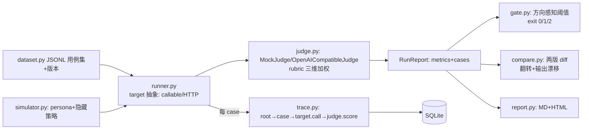

# PROJECT BOOK · agenteval 评测与可观测平台

> 配套：[README](../README.md)｜[compare_adr](compare_adr.md)｜[TAKEOVER](TAKEOVER.md)｜真 judge 校准报告 [../.agenteval/real_judge_calibration.md](../.agenteval/real_judge_calibration.md)
> 本书的行号以当前代码为准（关键锚点已核对；未标行号处给函数名定位）。

---

## 0. 一页定位

**是什么**：自研的 Agent 评测与可观测平台——数据集版本化、评测 runner、LLM-as-judge **校准**、CI 回归门禁、τ-bench 式用户模拟器、trace 落库、**多版本对比评测**。104 项 pytest 全绿；mock 全链路零成本可复现，真模型数字已升级（真 judge 校准 kappa 0.5455 见 §5）。

**回答哪道面试必答题**：2026 面经"eval pipeline 怎么搭"成必问、"你说优化了，优化了多少怎么测"是追问焦点、腾讯/小红书 JD 明写"评测体系/质量建设"。这个仓库是这三道题的**平台级答案**，且已真接 policy-compass/askbi 的 GitHub Actions 回归门禁（eval-gate job：mock 服务 → 30 条 smoke 打真 HTTP → gate exit 1 挡合并，零 key）——它评测的是我自己的项目，且 CI 会自动拦回归。

**组合叙事**：两个主项目（会做）+ 本平台（**会量化**）——"会做+会测"的分水岭叙事（面经原话"Demo 玩家 vs 工程玩家"）。

## 1. 技术栈全景

| 层 | 选型 | 为什么 | 被否方案 |
|---|---|---|---|
| trace 存储 | SQLite（runs/spans/events 三表，trace.py） | 请求级 span 树可 SQL 查询；单机评测场景零运维 | Langfuse（SaaS/自托管重）；纯 JSONL（无法按 run 聚合查询） |
| judge | provider 抽象：MockJudge（确定性规则）+ OpenAICompatibleJudge（真模型） | 校准实验必须可复现（mock）又可升级（真）；真 judge 校准已跑（kappa 0.5455） | 只用真 judge（不可复现、CI 不可跑） |
| 校准 | accuracy + Cohen's kappa + 混淆矩阵 + 阈值扫描（judge.py 校准模块） | kappa 修正类别不平衡的假象（30 条里 24 pass，accuracy 会骗人） | 只看 accuracy；人肉抽查 |
| 门禁 | gate.py：方向感知阈值 + exit 0/1/2 三态 | 成功率高好/P95 低好——方向写死在代码里；容忍噪声不误拦 | 全指标不许降（噪声永远误拦） |
| 数据集 | JSONL + 版本号 + 抽样/过滤/golden 标记（dataset.py） | 评测集是活的数据资产，必须版本化 | 无版本（分数变化无法归因） |
| 对比评测 | compare.py：指标 delta（复用 gate 方向感知）+ 逐用例翻转 + **输出漂移检测** | 门禁只答"能不能上线"；对比答"优化了多少、影响哪些 case" | 只看总分 |
| 模拟器 | simulator.py：persona + HiddenPolicy（τ-bench 思路） | 单轮 QA 测不出策略遵循 | 固定脚本对话 |
| 报告 | Markdown + 单文件 HTML（report.py，失败高亮+XSS 转义） | 双受众：机器（json/md）与人（html） | 只有一种 |

**显式取舍**：校准集 30 条与演示数据同源（过拟合风险已在 ADR 声明，生产需 200+ 独立标注）；观测台无鉴权；POST /runs 同步执行。

## 2. JD 要求映射（JD 原文 → 模块 → 面试指路）

| JD/真题原文 | 对应实现 | 指路 |
|---|---|---|
| 腾讯 JD："有 Agent 评测与质量体系建设经验" | 整个仓库 | "我从数据集管理到门禁自研了最小完整件" |
| 小红书 JD："自建评测集与指标" | dataset.py 版本化 + runner 分类型指标 | "评测集是活的资产，有版本号和坏例回流位" |
| 面经："Recall@5 0.81 你怎么知道好坏？baseline？" | runner 基线报告 + gate 阈值 + compare delta | "三步：与基线差值/分题型分解/代价量化" |
| 面经："LLM-as-judge 可靠吗？" | judge.py 校准 + selfeval + 真 judge 校准 0.5455（fn=6 严格偏置） | "判卷器本身也要考试；严格偏置跨模型复现" |
| 面经："eval pipeline 怎么搭？" | 五件套：数据集/runner/judge/校准/门禁 | "评测成本 15 万 token/遍 <¥0.5，配得上'随时可跑'" |
| 字节："长程任务怎么归因" | trace.py span 树 + api /spans 查询 | "先看事件时间线，再分工具慢还是模型慢" |

## 3. 全流程实现走读

**一条评测的生命**：`Runner.run(dataset)`（runner.py run 方法）→ 逐 case 开 span → target 归一化输出 → judge 打分（无 judge 时 error=失败）→ metrics 聚合（success_rate/judge_pass_rate/judge_mean/P50/P95/token）→ RunReport 落 JSON → gate 对比基线 → 报告三格式。异常兜底：单 case 异常记 error 不崩 run（runner 的 _run_case 容错）。

**judge 校准的生命**（selfeval.py）：build_cases() 构造 30 条 golden（故意埋 partial/vague/fabricated/swap 四类错误）→ v1 规则 judge 打分 → kappa/混淆矩阵 → 阈值扫描（t=3.6~4.6）→ 修订规则 → v2 复测。**真 judge 路径**：OpenAICompatibleJudge 同 golden 裸跑 → kappa 0.5455（fp=0/fn=6 严格偏置）——两次校准的对照是本仓库最深的一个叙事。

## 4. 代码内化路线

1. **tests/test_gate.py 先读**——门禁的判定规格（方向/阈值/退出码）全在测试里
2. **gate.py**（149 行）：compare_metrics 的方向感知分支——"为什么 higher/lower 分开写"
   - 动手：`python -m pytest tests/test_gate.py -v`
3. **runner.py**：Target 协议（callable/HTTP/adapter 三形态）→ run 主流程 → metrics 聚合
   - 动手：跑 `python -m agenteval.selfeval`（全链路 3 分钟）
4. **judge.py**：rubric prompt 结构（三维加权）→ MockJudge 规则 → 校准四件套
   - 动手：改一条 golden 标注重跑校准，看 kappa 怎么动
5. **compare.py**：指标 delta 复用 gate + 三类信号（回归/修复/输出漂移）
   - 自测题：为什么"输出漂移"是最有价值的信号？（答案在 compare_adr §2.2）
6. **trace.py + api.py**：span 树两遍重建 + 观测台
7. **重写关卡**（TAKEOVER §1）：judge 校准 / gate / simulator

**验收标准**：白板画出"一条评测的生命"全图；能口述两次校准实验（mock 0.51→0.89 / 真 judge 0.5455 严格偏置）；重写关卡全绿。

## 5. 面试讲法与追问防御

**30 秒版**："我自研了评测平台：数据集版本化、LLM-as-judge 带人工校准（kappa 从 0.51 修到 0.89）、CI 回归门禁（劣化自动拦截）、多版本对比评测（逐用例 diff+输出漂移）。已接入我自己的两个主项目做回归，真模型 judge 校准也跑了——kappa 0.5455，严格偏置与 mock v1 同构。"

**高危追问**：
1. "judge 校准集和演示数据同源，不是循环论证吗？"——是，已声明：30 条同源是演示上限，0.889 证明的是**校准流程有效**而非 judge 可信；生产需独立标注 200+ 条切分。
2. "真 judge kappa 才 0.55，你这平台没用吧？"——反了：这正是平台的价值——**它把"judge 不可信"从感觉变成了数字（fn=6 严格偏置）**，下一步阈值扫描+修 rubric 的工具全部现成。
3. "门禁阈值怎么定？"——DEFAULT_THRESHOLDS 是经验起步（成功率 2pp/均分 0.3），上线后按噪声水平回调；方向感知避免"P95 涨了但成功率也涨"的误拦。
4. "评测集怎么养？"——坏例回流+版本化+holdout（防过拟合修复），三机制互相咬合。

## 6. 边界与演进

- 校准集规模/同源性（见上）；真 judge 未做阈值扫描二轮；POST /runs 同步执行（长评测需队列）；观测台无鉴权；askbi 适配器只解析 final/error 帧。
- CI 门禁生效前提：agenteval 推送到与主项目同 owner 的 GitHub（yml 已就位）；门禁判的是 mock 口径下行为回归，语义等价的措辞变化会误报（keyword judge 已知边界，重出基线即可，见 docs/ci_integration.md §5）。
- 下一版三条：真 judge 二轮校准（阈值扫描+rubric 修订）→ 评测并发执行 → Langfuse 格式导出。
